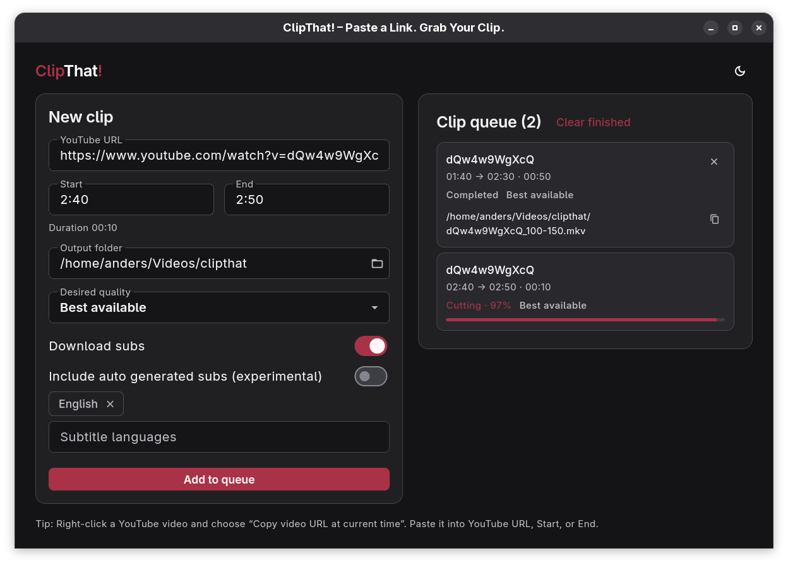

# ClipThat! – Paste a Link. Grab Your Clip.

**ClipThat!** is a desktop app for downloading and cutting YouTube clips in one go. Paste a YouTube link, choose a time range and output folder, and queue your clips. Clips are saved as H.264/AAC MKV with your selected VTT subtitle tracks when enabled.

**[Download ClipThat!](https://drjetski.com/projects/clipthat)**




## Installation

Download the latest package from my website [ClipThat! website](https://drjetski.com/projects/clipthat), or directly from [GitHub Releases](https://github.com/AndersKlint/yt-clip-extractor/releases).

- **Windows:** run the tagged installer (for example, `ClipThat-windows-x64-setup-v0.5.4-beta.exe`) to install, or extract the standalone ZIP (`ClipThat-windows-x64-v0.5.4-beta.zip`) and launch `ClipThat/yt_section_downloader.exe`. Both require the [Microsoft Visual C++ x64 runtime](https://aka.ms/vs/17/release/vc_redist.x64.exe), installed separately.
- **Linux:** install the downloaded Flatpak, then launch it:

  ```sh
  flatpak install --user ./ClipThat-linux-x64-v0.5.4-beta.flatpak
  flatpak run com.drjetski.clipthat
  ```

Use the exact tag of your downloaded release in place of `v0.5.4-beta`. Packages bundle yt-dlp, Deno, and FFmpeg.

## Development

Requires [Flutter stable](https://docs.flutter.dev/install) plus your native Flutter desktop toolchain:

- [Linux setup](https://docs.flutter.dev/platform-integration/linux/setup): Clang, CMake, Ninja, pkg-config, GTK 3 and C++ development libraries.
- [Windows setup](https://docs.flutter.dev/platform-integration/windows/setup): native Windows x64 with Visual Studio's **Desktop development with C++** workload and Windows SDK. Use native Windows Python and GNU Make. Packaging also requires [Inno Setup 6.3+](https://jrsoftware.org/isinfo.php).

From the repository root:

| Command | Purpose |
| --- | --- |
| `make run` | Build and launch the host app in release mode with bundled tools. |
| `make build` | Build a native Flutter release; stages tools on Linux, Flutter build only on Windows. |
| `make installer` | Package Linux Flatpak or both Windows installer EXE and portable ZIP. |

Linux Flatpak packaging needs GNU Make, Python 3.x, Git, and Flatpak tooling, but no host Flutter SDK or `FLUTTER_SDK`. Install the host dependencies (Ubuntu/Debian), then explicitly set up the Flatpak prerequisites and build:

```sh
sudo apt install flatpak flatpak-builder librsvg2-common bubblewrap curl git unzip xz-utils zip
make flatpak-setup
make flatpak-installer
```

`flatpak-builder` fetches Flutter's **stable** Git branch, bootstraps Flutter, resolves pub dependencies, and compiles/installs the app inside **GNOME SDK 50** for runtime ABI compatibility. Make stages freshly selected upstream tools through `scripts/bundle_tools.py`, validates them in the actual **GNOME Platform 50** runtime, then exports the Flatpak and checksum. Network access is required for Flutter sources/bootstrap, pub dependencies, and upstream tools. Host Flutter remains required for native development commands. Installed apps never download tools or fall back to PATH.

`make flatpak-setup` explicitly installs GNOME Platform/SDK 50 and `org.freedesktop.Sdk.Extension.llvm21//25.08`. The manifest uses this build-only LLVM extension with an immutable SDK; no host compiler or host-built Flutter bundle is used.

Packages go to `build/flatpak` on Linux and `dist/windows-x64` on Windows; override with `OUTPUT_DIR`. Linux output must be inside `build/` or outside the source tree. Existing Flatpak/checksum outputs are never overwritten: move them or choose a fresh output directory before rebuilding. Temporary staging is cleaned on exit; the output's `repo/` is retained.

See [tool packaging](packaging/tools/README.md) and [Windows packaging](packaging/windows/README.md) for details.

### GitHub release workflows

The [Linux](.github/workflows/release-linux.yml) and [Windows](.github/workflows/release-windows.yml) workflows retain packages and checksums as Actions artifacts. Manual runs need no tag and produce artifacts only. Pushing a `v*` tag publishes each successful platform's assets to one shared GitHub Release; failed platforms can be retried.

Separate publish jobs use `softprops/action-gh-release@v2`, job-scoped `contents: write`, and shared concurrency. Releases are nondraft and nonprerelease, without tag/pubspec matching, automatic version parsing, or generated notes.

Local packaging and Actions artifacts keep the untagged names `ClipThat-linux-x64.flatpak`, `ClipThat-windows-x64.zip`, and `ClipThat-windows-x64-setup.exe`. Only the publish jobs append the exact tag before the binary extension. For tag `v0.5.4-beta`, Release downloads are `ClipThat-linux-x64-v0.5.4-beta.flatpak`, `ClipThat-windows-x64-v0.5.4-beta.zip`, and `ClipThat-windows-x64-setup-v0.5.4-beta.exe`. Checksum filenames remain `SHA256SUMS-linux-x64` and `SHA256SUMS-windows-x64`; Release checksums are regenerated to reference the tagged binaries.

## License

ClipThat!'s own code is [MIT licensed](LICENSE). See [third-party notices](THIRD_PARTY_NOTICES.md) for metadata and bundled-component terms.
